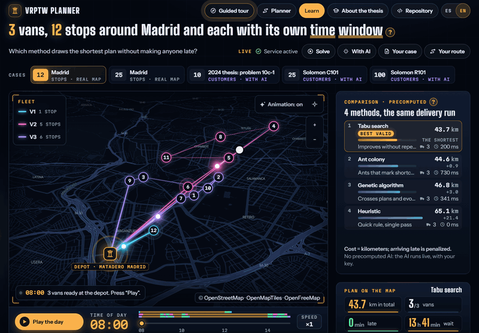

# VRPTW Planner

**English** · [Español](README.es.md)

Plan delivery routes where every customer has its own time window, and watch four classical methods and Claude models compete on the same problem.

**Live demo: [planificador-vrptw.vercel.app](https://planificador-vrptw.vercel.app/?lang=en)** (English and Spanish)



## What it does

- Five ready-made cases: two in Madrid on a real map, one problem from the 2024 thesis and two Solomon benchmark instances (25 and 100 customers).
- Compares a heuristic, ant colony optimization, a genetic algorithm and tabu search with Claude Opus, Sonnet and Haiku 5.5 in two roles: the model writes the plan in one go, or acts as an agent that calls the classical methods as tools and checks its own routes.
- Every plan goes through the same evaluator: distance, waiting, lateness and whether it is valid.
- Plays the day on the map with a clock, shows each van's schedule and explains the problem step by step on the Learn page.
- Live mode: solve your own case (CSV or addresses), draw your own route, or run the AI with your own Anthropic key, which is used only for that request.

The live service sleeps when idle and can take about a minute to wake up; the five cases load without it.

## One finding

On three 100-customer Solomon instances (two runs each), with the classical tools running without a time cap, Claude Opus 5.5 as an agent improved on the best classical solution its tools returned in 4 of 6 runs (by 0.06 % to 7 %); Sonnet and Haiku returned that best solution unchanged in all 6. That is a small sample: read it as a hint, not a result. In one of those runs Opus reached 827.3 on C101, checked with the evaluator, and only then wrote that the instance "appears to be Solomon's C101 benchmark" and that 827.3 matches its known optimum (the published one with distances truncated to one decimal), even though coordinates and IDs were disguised: a hint that well-known benchmarks may be memorized (2 of the 234 disguised runs name Solomon).

All 318 runs, with prompts, responses, tool calls and cost (USD 28.37 in total), are in `api/runs/`.

## Layout

- `api/`: Python backend (solver, algorithms and API).
- `web/`: Next.js frontend.

## Requirements

- [uv](https://docs.astral.sh/uv/), with Python 3.12 or later (tested with 3.14).
- Node.js 24 or later, with npm.

## Run locally

Service, from `api/`. Keys go in `api/.env` (template: `.env.example` at the root) and none is required: without them, geocoding returns 503 and the matrix uses straight-line distances.

```
uv sync
uv run --env-file .env uvicorn vrptw.api.main:app
```

Web, from `web/`. It calls the service at `http://127.0.0.1:8000` unless `NEXT_PUBLIC_API_URL` says otherwise.

```
npm ci
npm run dev
```

To try the LLM routes without a key or cost, start the service with `VRPTW_LLM_PROVIDER=fake` (see "Test mode" below).

## Tests

From `api/`:

```
uv sync --locked
uv run ruff check .
uv run ruff format --check .
uv run mypy src
uv run pytest -q
uv run pytest -q -m legado
uv run python -m compileall -q src
```

`-m legado` is the regression against the 2024 results and takes a few minutes.

From `web/`. Playwright starts the service with the fake provider (port 8010, no keys) and the web app (port 3100) on its own, so it needs `uv` on the PATH and those ports free:

```
npm ci
npx playwright install chromium
npm run lint
npm run build
npx tsc --noEmit
npx playwright test --project=mobile-390 --project=desktop-1440
```

Contract and data: after `npm run gen:types` (in `web/`) and `uv run vrptw bench export` (in `api/`), `git status` must show no changes.

## Benchmark

From `api/`. Each run is stored as a JSON `RunRecord` in `api/runs/`.

- Classical methods, offline: `uv run vrptw bench classic --tier N --reps 30`. Tiers: 1, four problems from 2024; 2 and 3, six Solomon instances with 25 and 50 customers; 4, C101, R101 and RC101 with 100.
- LLM: `uv run vrptw bench estimate` estimates the cost without any calls. `uv run vrptw bench llm --tier N` shows the plan and its worst-case spend without calling anything; with `--confirm` and `ANTHROPIC_API_KEY` it runs it, checking a global cap against the spending ledger (`api/runs/ledger.json`) before each call. Runs already done are in `api/runs/llm/` and are reused.
- Web cases: `uv run vrptw bench export` rebuilds `web/public/data/` from those records, offline and at no cost.

## Deployment

- Service: Render, free plan, with the `render.yaml` Blueprint. The Geoapify and openrouteservice keys are filled in on the dashboard; `VRPTW_CORS_ORIGINS` is the web app's URL.
- Web: Vercel, with root `web/` and `NEXT_PUBLIC_API_URL` set to the service's public URL. Without that variable, the Vercel build fails.

## Documentation (in Spanish)

- `docs/formato-csv.md`: the CSV template for real-world cases.
- `docs/fuentes/`: external data (prices, quotas, Solomon instances, hosting, maps and fonts) with their URL and date of access.

## Origin

This project updates a 2024 master's thesis (UNIR, MSc in Artificial Intelligence) to today's AI models; credits are on the [About the thesis](https://planificador-vrptw.vercel.app/sobre/?lang=en) page. The classical methods (heuristic, ant colony, genetic algorithm and tabu search) and the 20 problems in `api/data/tfe2024/` build on the thesis's original code: [oscarsr96/tfm_vrptw_osr_jsr](https://github.com/oscarsr96/tfm_vrptw_osr_jsr) (commit `c3ad94c`).

MIT license (`LICENSE`).

## Service

HTTP API: CSV parsing, geocoding, distance matrix, classical methods, route evaluation and two LLM routes (`/solve/llm` and `/explain`). From `api/`:

```
uv run --env-file .env uvicorn vrptw.api.main:app
```

| Variable | Use |
|---|---|
| `VRPTW_CORS_ORIGINS` | Allowed origins, comma-separated (default `http://localhost:3000`). |
| `GEOAPIFY_API_KEY` | Geocoding (`/geocode`). Without it, returns 503. |
| `ORS_API_KEY` | Road matrix (`/matrix`). Without it, once the daily cap is used up or if the service fails, returns straight-line distances (`source` = `haversine_fallback`). |
| `VRPTW_LLM_PROVIDER` | `anthropic` (default) or `fake`: test mode, see below. Read on every request. |

Routes: `GET /health`, `GET /models`, `POST /instances/parse-csv`, `POST /geocode`, `POST /matrix`, `POST /solve/classic`, `POST /evaluate`, `POST /solve/llm`, `POST /explain`.

LLM routes: the user's Anthropic key arrives in the `X-LLM-Key` header (missing or empty, 401), is used only during the request and is neither stored nor logged.

- `POST /solve/llm`: `{instance, model, role, recheck, seed}`, with `role` `llm_direct` or `llm_agent`, `recheck` false by default and `seed` greater than or equal to 0. `model` must be one of `GET /models` (otherwise 422). Returns the evaluated `RunRecord`, without writing it to disk. Solomon instances are sent to the model disguised (`params.camouflaged`); `messages` and `tool_calls` keep the disguised numbering, and `solution` and `evaluation` use the original instance's. To be disguised, a Solomon instance needs X/Y coordinates on every node, customers numbered 1 to n and a matrix equal to the Euclidean distances of its coordinates (truncated if `matrix.source` is `euclidean_truncated`); otherwise 422. An instance with X/Y coordinates and a traffic profile also returns 422: traffic is only accepted on map-based cases (`/solve/classic` and `/evaluate` do accept it).
- `POST /explain`: `{instance, routes, method, model, lang}` (`method` up to 40 characters; `lang`, `es` or `en`, default `es`). The server re-evaluates the routes and asks the model, in a single call, for a short explanation in that language. Returns `{text, model_returned, tokens_in, tokens_out, api_cost_eur, stop_reason}`.

Provider errors: key rejected, 401; rate limit, 429; anything else, 502. A timeout in `/solve/llm` is a record with `parse_status` `timeout`. Any other internal failure returns 500 `{"detail": "error interno"}`, with no message or trace.

**Test mode.** With `VRPTW_LLM_PROVIDER=fake` both routes respond offline and at no cost: `/solve/llm` returns the heuristic's routes, without calling tools, and `/explain` a fixed text saying it is a test response. The `X-LLM-Key` header is still required (any value).

Limits: body up to 2 MB (larger, 413; a POST without `Content-Length` or chunked, 411); at most 100 customers and 100 vehicles; CSV up to 100,000 characters; 101 addresses or points per request; `time_limit_s` up to 60 s; 100 routes and 200 IDs in `/evaluate`; all numbers finite, with absolute value no greater than 1e9 and non-negative where applicable (`cost_profile` weights included); `id`, `matrix.source` and units up to 100 characters, and name and addresses up to 200. One classical computation at a time: if another is running, `/solve/classic` returns 503 with `Retry-After: 5`. That lock does not cover `/solve/llm`: the agent's tools run the classical methods without going through it. Geocoding works best with full addresses (street, city and country), because Geoapify biases results by the server's location.

Daily caps for the map services: 1,000 addresses on `/geocode` (beyond that, 429) and 150 `/matrix` requests with `ORS_API_KEY` (beyond that, straight line). They are a third of Geoapify's 3,000 daily geocodings on the free plan and, at up to 3 calls per matrix, 450 of openrouteservice's 500 daily Matrix requests (`docs/fuentes/hosting-y-mapas.md`). The counters are global and in memory: they reset when the UTC date changes or when the service restarts, and they also count what the cache answers. There is no per-IP limit; that is left to the hosting platform.

Errors: the body is `{"detail": "text"}`, except for 422, which is `{"detail": [{"loc", "msg"}]}` (`loc`, the dotted field path, e.g. `instance.customers.3.due`) or, for CSV rows, `{"detail": [{"row", "msg"}]}`. Codes: 401 (missing `X-LLM-Key` or the provider rejects the key), 411, 413, 422, 429 (daily cap or provider limit), 500 (internal error, no message or trace), 502 (LLM provider failure) and 503 (geocoding unavailable or another computation running). With an allowed origin, every error response, 500 included, carries the CORS headers. The OpenAPI spec declares the ones each route can return.
